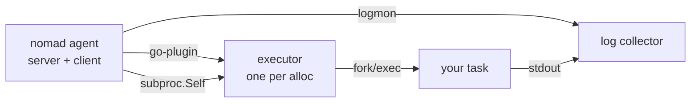

# Nomad on every platform

This fork of Nomad adds a working Android target: the client runs on an
Android device and supervises plain binaries with the `raw_exec` driver,
without Docker and without a container runtime.

Everything here was verified on real hardware. Where something is a platform
limitation rather than a bug, it says so.

## What this fork changes

| Area | Change |
| --- | --- |
| Android | The client no longer refuses every allocation when the platform has no user database |
| Android | `executable_path` / `NOMAD_EXECUTABLE` let helpers re-execute a real binary |
| Android | The Docker driver is not registered; Android has no daemon |
| Android | cgroup detection handles layered cgroup mounts |
| All Linux | tmpfs mounts leaked by an unclean shutdown are swept |

Details: [contributing/android.md](../contributing/android.md).

## Downloads

Each release publishes seven archives. Pick the one matching the machine that
will run Nomad, not the machine you are typing on.

| Platform | Archive | Runs on |
| --- | --- | --- |
| Linux | `nomad_<version>_linux_amd64.zip` | x86_64 servers |
| Linux | `nomad_<version>_linux_arm64.zip` | arm64 servers, Raspberry Pi 4/5 |
| macOS | `nomad_<version>_darwin_amd64.zip` | Intel Macs |
| macOS | `nomad_<version>_darwin_arm64.zip` | Apple Silicon |
| Windows | `nomad_<version>_windows_amd64.exe` | Windows 10/11, Server 2016+ |
| Android | `nomad_<version>_android_arm64.so` | arm64 phones, boards (RK3399, RK3588) |
| Android | `nomad_<version>_android_amd64.so` | x86_64 devices, emulators, redroid |

The Android files carry a `.so` extension because that is the only form
Android will execute from inside an APK. Unzipped they are ordinary
executables; run them as `nomad`.

The macOS archives are unsigned and unnotarised. See the macOS page for the
one command that clears the quarantine flag.

## Install guides

| Platform | Guide | Notes |
| --- | --- | --- |
| Linux | [install/linux.md](install/linux.md) | systemd unit, data dir, ports |
| macOS | [install/macos.md](install/macos.md) | Gatekeeper, launchd, dev mode |
| Windows | [install/windows.md](install/windows.md) | service registration, firewall |
| Android | [install/android.md](install/android.md) | three deployment shapes |

Problems encountered, with causes and fixes, are collected in
[troubleshooting.md](troubleshooting.md). Read that page before filing an
issue; most surprises on Android are documented there.

Runnable examples live in [examples/](examples/README.md).

## How a task runs

Nomad does not fork your binary directly. The client starts a driver, the
driver starts an executor, and the executor starts your task. Each arrow below
is a separate process, which matters on Android where a binary is not always
executable in place.



Both helper processes re-execute the Nomad binary. If the running image cannot
be executed again, they are pointed at a copy with `executable_path`:

```hcl
executable_path = "/data/local/tmp/nomad"
```

See [troubleshooting.md](troubleshooting.md#helpers-cannot-start) for what
happens without it.

## Quick check

Any platform, once the binary is in place:

```sh
nomad version
nomad agent -dev &
nomad node status
```

`-dev` runs a server and client in one process with in-memory state. It is for
testing only; it destroys allocations on shutdown.

Next: pick your platform guide above, or run the examples.