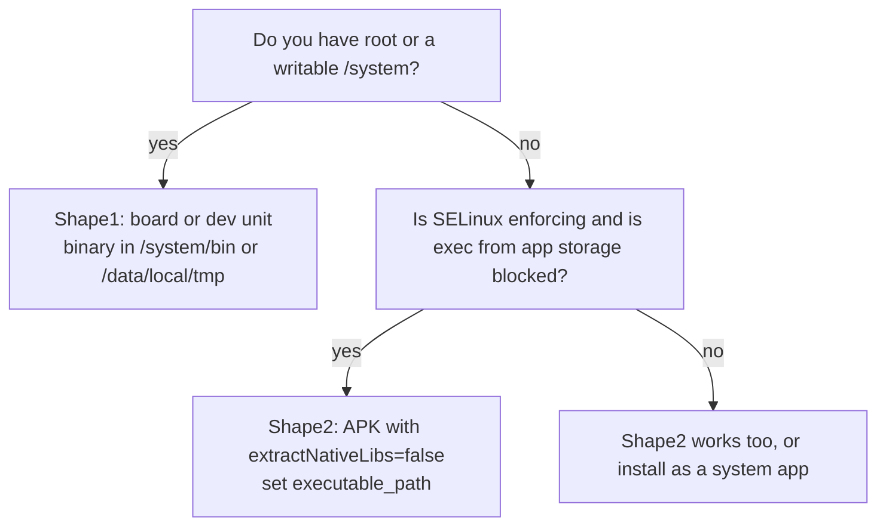

# Installing Nomad on Android

Nomad runs on Android as an ordinary binary. Most Android devices have no Docker
and cannot run one, so the `raw_exec` driver is the point: it starts plain
binaries and supervises them.

Two things make Android different from Linux, and both are fatal if ignored:

1. Android has no user database. `/etc/passwd` does not exist and uids come from
 bionic's `AID_*` tables. Anything that resolves a username by name fails.
 This fork degrades instead of aborting.
2. Android restricts where a binary may live and be executed from. The running
 image is often not executable, and Nomad re-executes itself for its helpers.

Read the section matching your device before starting.

## Which shape are you in?



Check quickly:

```sh
adb shell getenforce # Enforcing or Permissive
adb shell id # uid=0 means adb is root
adb shell 'echo test > /data/local/tmp/x && chmod 755 /data/local/tmp/x && /data/local/tmp/x'
```

If the last command prints `test`, `/data/local/tmp` is executable and shape1
applies.

## Shape1: rooted board or development unit

Verified on a Rockchip RK3399 running Android 8.1, and on a redroid Android 12
image.

### Install

```sh
VERSION=2.1.1
ABI=arm64 # or amd64 for x86_64 devices

adb push nomad_${VERSION}_android_${ABI}.so /data/local/tmp/nomad
adb shell chmod 755 /data/local/tmp/nomad
adb shell /data/local/tmp/nomad version
```

The `.so` name is only about packaging. After `chmod 755` it is an ordinary
executable.

### Configure

`/data/local/nomad/android.hcl`:

```hcl
data_dir = "/data/local/nomad/data"
bind_addr = "0.0.0.0"
log_level = "INFO"

# These devices are frequently offline; the update check only adds noise.
disable_update_check = true

server {
 enabled = true
 bootstrap_expect = 1
}

client {
 enabled = true
 options = {
 "driver.raw_exec.enable" = "1"
 }
}
```

```sh
adb shell mkdir -p /data/local/nomad/data
adb push android.hcl /data/local/nomad/android.hcl
```

### Start

The launcher in this repository handles detachment and pid tracking:

```sh
adb push demo/android/nomad-android.sh /data/local/nomad/
adb shell chmod 755 /data/local/nomad/nomad-android.sh
adb shell 'NOMAD_EXECUTABLE=/data/local/tmp/nomad \
 NOMAD_CONF=/data/local/nomad/android.hcl \
 sh /data/local/nomad/nomad-android.sh start'
adb shell 'sh /data/local/nomad/nomad-android.sh status'
```

Without the script:

```sh
adb shell 'setsid /data/local/tmp/nomad agent -config=/data/local/nomad/android.hcl'
```

`setsid` detaches from the adb shell so the agent is reparented to init instead
of dying with the session.

### Reach the API

```sh
adb forward tcp:4646 tcp:4646
nomad node status
```

On a device with a real network address you can use it directly:

```sh
nomad node status -address http://192.168.8.191:4646
```

### Boot persistence

`/system/etc/init/nomad.rc`, installed on a writable `/system`:

```sh
adb root && adb remount
adb push nomad_${VERSION}_android_arm64.so /system/bin/nomad
adb shell chmod 755 /system/bin/nomad
adb push demo/android/nomad.rc /system/etc/init/nomad.rc
adb shell chmod 644 /system/etc/init/nomad.rc
adb reboot
```

Verify:

```sh
adb shell getprop init.svc.nomad # running
adb shell 'ps -A -o PID,PPID,NAME | grep nomad' # ppid1
```

Two details in that file are load-bearing; both are explained in
[../troubleshooting.md](../troubleshooting.md#init-never-starts-the-service).

## Shape2: APK, no root

For devices where `/system` cannot be modified. The agent runs as an app uid,
inside the app sandbox.

```sh
NOMAD_NO_UI=1 make pkg/android_arm64/nomad
demo/android/apk/build.sh pkg/android_arm64/nomad.so
adb install -r demo/android/apk/build/nomad-android.apk
adb shell am start -n com.hashicorp.nomadandroid/.StartActivity
adb logcat -s NomadService
```

The app writes a config on first launch and starts the agent. Two directories
must exist and be writable before it will work, because of the unix socket path
limit and a fixed mounts directory:

```sh
adb shell mkdir -p /data/local/tmp/nd /data/local/tmp/alloc_mounts
adb shell chmod 777 /data/local/tmp/nd /data/local/tmp/alloc_mounts
```

Full details, including why `TMPDIR` matters:
[demo/android/apk/README.md](../../demo/android/apk/README.md).

## Verify a job runs

```sh
nomad job run demo/android/job-9801.nomad
nomad job status http-9801
curl http://<device-ip>:9801/
```

Expected output is `svc-a`. The companion job answers `svc-b` on port 9802,
which proves two instances were placed independently.

To check the process tree, which is the real proof that the helper re-exec
worked:

```sh
adb shell 'ps -A -o PID,PPID,NAME | grep -E "nomad|nc"'
```

You should see the agent, one executor per allocation, and the task:

```
3617 1 nomad
3648 3617 nomad
3658 3648 toybox
```

If the agent is there but no executor, the helpers could not start. See
[../troubleshooting.md](../troubleshooting.md#helpers-cannot-start).

## What works, what does not

| Feature | Status |
| --- | --- |
| `raw_exec` | Works. Tasks run as the agent's uid |
| `exec` driver | Not built for arm64. Needs cgo and libcontainer |
| `docker` driver | Not registered. Android has no daemon |
| Bridge networking, CNI | No. Use `network { mode = "host" }` |
| cgroup resource limits | Not enforced in practice; see below |
| Task log collection (`logmon`) | Works but fragile; prefer `logs { disabled = true }` |
| CSI volumes | Depends on the plugin having an Android build |
| Consul, Vault | Reachable over the network, if they exist somewhere |

`resources { cpu, memory }` is used for placement decisions but not enforced on
Android. `cgroup.controllers` is empty on many images, so there is nothing to
write a limit into.

## Device notes

| Device | Result |
| --- | --- |
| RK3399, Android 8.1, arm64, SELinux permissive | Works. cgroups v1, kernel 4.4 |
| redroid, Android 12, x86_64, SELinux disabled | Works. cgroups v2 layered over v1 |
| Android10+ with SELinux enforcing, no root | Needs shape2 |

On the x86_64 image the container address is `172.17.0.3` rather than the host
address, so `adb forward` is the way in.

## Uninstall

```sh
adb shell 'NOMAD_CONF=/data/local/nomad/android.hcl \
 sh /data/local/nomad/nomad-android.sh stop'
adb shell rm -rf /data/local/nomad
```

For shape1 with boot persistence, remove the init file and reboot:

```sh
adb root && adb remount
adb shell rm /system/etc/init/nomad.rc /system/bin/nomad
adb reboot
```

For shape2, `adb uninstall com.hashicorp.nomadandroid`.

Unmounting is worth checking after a forced kill; leaked tmpfs mounts are
documented in [../troubleshooting.md](../troubleshooting.md#tmpfs-mounts-pile-up).

## Stopping is not the same as killing

`kill` on the agent leaves the workload running. That is deliberate: the client
leaves allocations alone on `SIGTERM` so a restart does not interrupt them, and
the executors are reparented to init. To actually stop work:

```sh
nomad job stop <job>
```

The launcher script does this for you before signalling the agent.