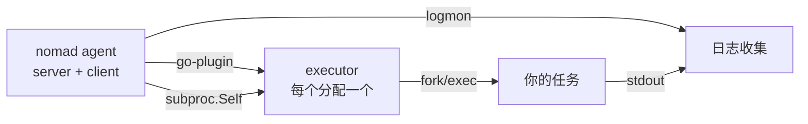

#各平台安装与使用手册

本仓库是 Nomad的一个分支，增加了可用的 Android目标：客户端可以跑在
Android设备上，用 `raw_exec`驱动直接托管二进制程序，**不需要 Docker，
也不需要任何容器运行时**。

本文档中的所有内容都在真机上验证过。凡是属于平台限制而非缺陷的地方，
都会明确说明。

##本分支改了什么

|范围 |改动 |
| --- | --- |
| Android |平台没有用户数据库时，客户端不再让每个分配都失败 |
| Android |新增 `executable_path` / `NOMAD_EXECUTABLE`，让辅助进程能重新执行真实的二进制 |
| Android |不再注册 Docker驱动；Android上没有守护进程可连 |
| Android | cgroup检测支持多层挂载的镜像 |
|全部 Linux |非正常退出遗留的 tmpfs会在下次分配时清理 |

细节见 [../contributing/android.md](../../contributing/android.md)。

##下载

每个版本发布7个压缩包。请按**将要运行 Nomad的机器**选择，而不是按你
当前打字的机器。

|平台 |文件 |适用 |
| --- | --- | --- |
| Linux | `nomad_<版本>_linux_amd64.zip` | x86_64服务器 |
| Linux | `nomad_<版本>_linux_arm64.zip` | arm64服务器、树莓派4/5 |
| macOS | `nomad_<版本>_darwin_amd64.zip` | Intel Mac |
| macOS | `nomad_<版本>_darwin_arm64.zip` | Apple Silicon |
| Windows | `nomad_<版本>_windows_amd64.exe` | Windows 10/11、Server 2016及以上 |
| Android | `nomad_<版本>_android_arm64.so` | arm64手机、开发板（RK3399、RK3588） |
| Android | `nomad_<版本>_android_amd64.so` | x86_64设备、模拟器、redroid |

Android的文件带 `.so`后缀，因为这是 Android允许从 APK内执行的唯一形式。
解压后它就是普通可执行文件，按 `nomad`使用即可。

macOS的压缩包未签名、未公证，需要执行一条命令清除隔离属性，
见 [install/macos.md](install/macos.md)。

##安装指南

|平台 |指南 |说明 |
| --- | --- | --- |
| Linux | [install/linux.md](install/linux.md) | systemd单元、数据目录、端口 |
| macOS | [install/macos.md](install/macos.md) | Gatekeeper、launchd、开发模式 |
| Windows | [install/windows.md](install/windows.md) |服务注册、防火墙 |
| Android | [install/android.md](install/android.md) |三种部署形态 |

真机上遇到的问题、原因和解决办法统一收集在
[troubleshooting.md](troubleshooting.md)。**遇到问题请先读这一页**，
Android上绝大多数意外都记录在里面。

可直接运行的示例在 [examples/](examples/README.md)。

##一个任务是怎么跑起来的

Nomad并不直接 fork你的程序。客户端启动驱动，驱动启动执行器（executor），
执行器再启动你的任务。下图每一条箭头都是一个独立进程，这一点在 Android上
很关键，因为二进制不总是能在原地执行。



两个辅助进程都会重新执行 Nomad自身的二进制。如果运行中的镜像无法再次执行，
就用 `executable_path`指向一份副本：

```hcl
executable_path = "/data/local/tmp/nomad"
```

不这么做会看到什么，见
[troubleshooting.md](troubleshooting.md#辅助进程起不来)。

##快速自检

任何平台，二进制就位之后：

```sh
nomad version
nomad agent -dev &
nomad node status
```

`-dev`在单个进程里跑服务端和客户端，状态只在内存中，仅用于测试，
退出时会销毁所有分配。

想一键完成"起 agent、等节点就绪、跑一个任务、报告结果"，
用仓库里的脚本：

```sh
./docs/smoke-test.sh /path/to/nomad
```

脚本退出码为0表示链路通。

接下来请选对应平台的指南，或直接跑示例。
