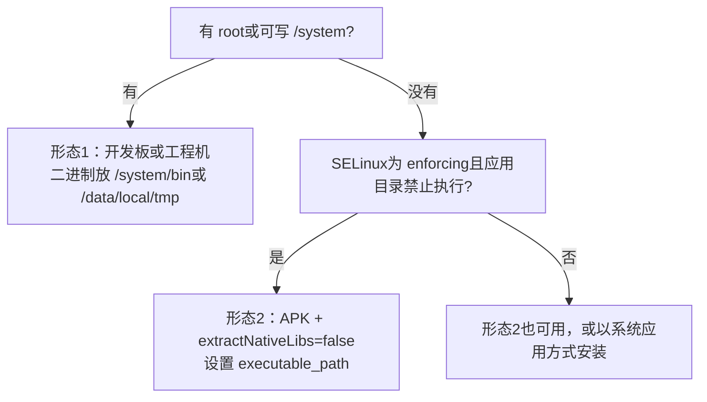

#在 Android上安装 Nomad

Nomad在 Android上作为普通二进制运行。绝大多数 Android设备没有 Docker、
也无法运行 Docker，所以本分支的重点是 `raw_exec`驱动：它直接启动二进制并托管。

Android与 Linux有两处关键差异，**任何一处忽略都会导致完全跑不起来**：

1. **Android没有用户数据库**。不存在 `/etc/passwd`，uid来自 bionic的
 `AID_*`常量表。任何按用户名解析用户的代码都会失败。本分支改为降级处理，
而不是直接中止。
2. **Android限制了二进制能放在哪里、能否执行**。运行中的镜像常常无法再次
执行，而 Nomad为了启动辅助进程**必须重新执行自己**。

请先读与你的设备对应的那一节。

##你属于哪种形态



快速判断：

```sh
adb shell getenforce # Enforcing或 Permissive
adb shell id # uid=0说明 adb有 root
adb shell 'echo test > /data/local/tmp/x && chmod 755 /data/local/tmp/x && /data/local/tmp/x'
```

最后一条如果能打印 `test`，说明 `/data/local/tmp`可执行，适用形态1。

##形态1：有 root的开发板或工程机

在 Rockchip RK3399（Android 8.1）和 redroid（Android 12）镜像上验证过。

###安装

```sh
VERSION=2.1.1
ABI=arm64 # x86_64设备用 amd64

adb push nomad_${VERSION}_android_${ABI}.so /data/local/tmp/nomad
adb shell chmod 755 /data/local/tmp/nomad
adb shell /data/local/tmp/nomad version
```

`.so`只是打包形式。执行过 `chmod 755`之后它就是普通可执行文件。

###配置

`/data/local/nomad/android.hcl`：

```hcl
data_dir = "/data/local/nomad/data"
bind_addr = "0.0.0.0"
log_level = "INFO"

#这类设备经常离线，更新检查只会刷噪音日志
disable_update_check = true

server {
 enabled = true
 bootstrap_expect = 1
}

client {
 enabled = true
 options = {
 "driver.raw_exec.enable" = "1"
 }
}
```

```sh
adb shell mkdir -p /data/local/nomad/data
adb push android.hcl /data/local/nomad/android.hcl
```

###启动

仓库里的启动脚本负责脱离终端和 pid跟踪：

```sh
adb push demo/android/nomad-android.sh /data/local/nomad/
adb shell chmod 755 /data/local/nomad/nomad-android.sh
adb shell 'NOMAD_EXECUTABLE=/data/local/tmp/nomad \
 NOMAD_CONF=/data/local/nomad/android.hcl \
 sh /data/local/nomad/nomad-android.sh start'
adb shell 'sh /data/local/nomad/nomad-android.sh status'
```

不用脚本的话：

```sh
adb shell 'setsid /data/local/tmp/nomad agent -config=/data/local/nomad/android.hcl'
```

`setsid`让进程脱离 adb会话，交给 init接管，否则 adb一断 agent就死。

###访问 API

```sh
adb forward tcp:4646 tcp:4646
nomad node status
```

设备有独立网络地址时可直接访问：

```sh
nomad node status -address http://192.168.8.191:4646
```

###开机自启

`/system/etc/init/nomad.rc`，需要可写的 `/system`：

```sh
adb root && adb remount
adb push nomad_${VERSION}_android_arm64.so /system/bin/nomad
adb shell chmod 755 /system/bin/nomad
adb push demo/android/nomad.rc /system/etc/init/nomad.rc
adb shell chmod 644 /system/etc/init/nomad.rc
adb reboot
```

验证：

```sh
adb shell getprop init.svc.nomad # running
adb shell 'ps -A -o PID,PPID,NAME | grep nomad' # ppid为1
```

那个文件里有两处细节是**缺一不可**的，原因见
[../troubleshooting.md](../troubleshooting.md#init从不启动服务)。

##形态2：APK，无 root

适用于 `/system`不可修改的设备。agent以应用 uid运行，处在应用沙箱内。

```sh
NOMAD_NO_UI=1 make pkg/android_arm64/nomad
demo/android/apk/build.sh pkg/android_arm64/nomad.so
adb install -r demo/android/apk/build/nomad-android.apk
adb shell am start -n com.hashicorp.nomadandroid/.StartActivity
adb logcat -s NomadService
```

应用首次启动会自己写配置并拉起 agent。但有两个目录必须**提前存在且可写**，
原因是 unix socket的路径长度上限和一个固定的挂载目录：

```sh
adb shell mkdir -p /data/local/tmp/nd /data/local/tmp/alloc_mounts
adb shell chmod 777 /data/local/tmp/nd /data/local/tmp/alloc_mounts
```

为什么需要 `TMPDIR`等完整说明见
[../../../demo/android/apk/README.md](../../../demo/android/apk/README.md)。

##验证任务能跑

```sh
nomad job run demo/android/job-9801.nomad
nomad job status http-9801
curl http://<设备IP>:9801/
```

预期输出 `svc-a`。配套的另一个 job在 9802端口返回 `svc-b`，
用来证明两个实例是独立放置的。

要确认真实的进程树（这是辅助进程能否重执行成功的唯一硬证据）：

```sh
adb shell 'ps -A -o PID,PPID,NAME | grep -E "nomad|nc"'
```

应该能看到 agent、每个分配一个 executor，以及任务本身：

```
36171 nomad
36483617 nomad
36583648 toybox
```

如果只有 agent、没有 executor，说明辅助进程没起来，见
[../troubleshooting.md](../troubleshooting.md#辅助进程起不来)。

##能力边界

|功能 |状态 |
| --- | --- |
| `raw_exec` |可用。任务以 agent的 uid运行 |
| `exec`驱动 |arm64未构建。它需要 cgo和 libcontainer |
| `docker`驱动 |未注册。Android没有守护进程 |
|桥接网络、CNI |不可用。请用 `network { mode = "host" }` |
| cgroup资源限制 |实际不生效，见下 |
|任务日志收集（logmon）|能用但脆弱，建议 `logs { disabled = true }` |
| CSI卷 |取决于插件是否有 Android构建 |
| Consul、Vault |只要网络可达就可用 |

`resources { cpu, memory }`参与放置决策，但 Android上**不强制执行**。
很多镜像的 `cgroup.controllers`是空的，没有地方写入限制。

##设备实测记录

|设备 |结果 |
| --- | --- |
| RK3399、Android 8.1、arm64、SELinux permissive |可用。cgroups v1，内核 4.4 |
| redroid、Android12、x86_64、SELinux disabled |可用。cgroups v2叠加在 v1之上 |
| Android10以上、SELinux enforcing、无 root |需形态2 |

x86_64镜像是容器网络，地址是 `172.17.0.3`而不是宿主机地址，
所以只能通过 `adb forward`进去。

##卸载

```sh
adb shell 'NOMAD_CONF=/data/local/nomad/android.hcl \
 sh /data/local/nomad/nomad-android.sh stop'
adb shell rm -rf /data/local/nomad
```

形态1且配了开机自启的，先删文件再重启：

```sh
adb root && adb remount
adb shell rm /system/etc/init/nomad.rc /system/bin/nomad
adb reboot
```

形态2执行 `adb uninstall com.hashicorp.nomadandroid`。

强制 kill之后建议检查一次挂载，遗留的 tmpfs见
[../troubleshooting.md](../troubleshooting.md#tmpfs挂载越积越多)。

##停止不等于 kill

对 agent执行 `kill`**不会停止任务**。这是刻意的：客户端在收到 `SIGTERM`时
故意不动分配，以免重启打断业务，executor会被 init接管继续跑。
要真正停负载：

```sh
nomad job stop <任务名>
```

启动脚本会在给 agent发信号之前自动做这件事。
